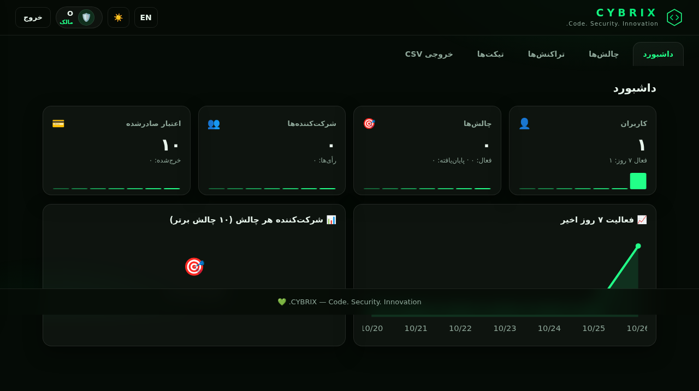
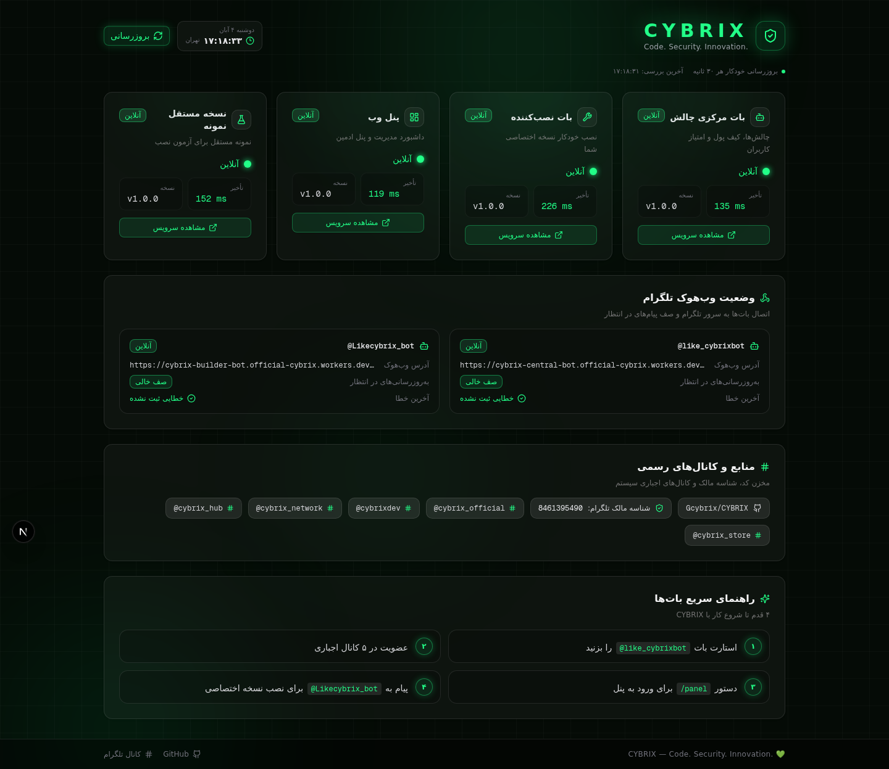

<div align="center">


# CYBRIX

**Code. Security. Innovation.**

پلتفرم ساخت و مدیریت چالش در تلگرام — روی Cloudflare Workers + D1، بدون سرور
Telegram Challenge Platform — serverless on Cloudflare Workers + D1

[](.github/workflows/ci.yml)


</div>

---

## 🇮🇷 فارسی

CYBRIX سه محصول واقعی و مستقل است:

| محصول | توضیح | وضعیت |
|---|---|---|
| **بات مرکزی چالش** ([@like_cybrixbot](https://t.me/like_cybrixbot)) | مدیران کانال‌ها بدون کدنویسی چالش می‌سازند: قرعه‌کشی، رأی‌گیری، دعوت، آزمون | ✅ مستقر و آنلاین |
| **بات نصب‌کننده** ([@Likecybrix_bot](https://t.me/Likecybrix_bot)) | نصب نسخه اختصاصی روی حساب Cloudflare خود کاربر به‌صورت هدایت‌شده | ✅ مستقر و آنلاین |
| **نسخه مستقل** | همان هسته، با دیتابیس و Secrets مستقل — قابل نصب از طریق بات نصب‌کننده | ✅ مستقر (نمونه: cybrix-demo) |
| **پنل وب** | داشبورد آمار، چالش‌ها، تراکنش‌ها، CSV، فارسی/RTL + انگلیسی، تم تاریک/روشن | ✅ مستقر و آنلاین |

### امکانات کلیدی
- 🎲 **قرعه‌کشی امن** با Commit–Reveal cryptographic + اثبات شفافیت قابل بررسی مستقل
- 🗳 رأی‌گیری با یک رأی برای هر کاربر، قابل تغییر، شمارش عمومی
- 👆 دعوت با لینک اختصاصی + شمارش فقط دعوت‌های معتبر
- 🧠 آزمون چندسؤالی با امتیازدهی
- 💳 کیف پول اعتباری با دفترکل ممیزی‌پذیر (رایگان/هدیه/خریداری‌شده تفکیک‌شده)
- 🔒 عضویت اجباری کانال‌ها (۵ کانال رسمی CYBRIX در نسخه مرکزی)
- 🛡 ضدتقلب چندلایه: محدودیت نرخ، ضدتکرار آپدیت، بررسی عضویت در پایان، امتیاز ریسک، Audit کامل
- 🌐 پنل وب RTL با نمودار SVG، خروجی CSV، ورود با کد یک‌بارمصرف از بات

### معماری
```
Telegram ⇄ Cloudflare Workers (4) ⇄ D1 (SQLite)
                    └─ پنل وب (Worker) ⇄ همان D1
```
- `apps/central-bot` — بات مرکزی + Webhook + Cron
- `apps/builder-bot` — بات نصب‌کننده (Cloudflare REST API + استقرار خودکار)
- `apps/standalone-bot` — نسخه مستقل قابل انتشار
- `apps/web-panel` — پنل وب (SPA بدون وابستگی خارجی)
- `packages/*` — اسکیما، i18n، تست‌ها

### اسکرین‌شات‌های واقعی (سیستم مستقرشده)
| پنل وب | داشبورد مانیتورینگ |
|---|---|
|  |  |

> بقیه اسکرین‌شات‌ها: [docs/screenshots](docs/screenshots)

### شروع سریع
```bash
git clone https://github.com/Gcybrix/CYBRIX.git && cd CYBRIX
cp .env.example secrets.local.env   # توکن‌های خودتان را بگذارید (هرگز commit نکنید)
bun install
bun test                             # 13/13 ✔
bash scripts/build.sh                # باندل ۴ ورکر
bun scripts/deploy.ts                # استقرار روی Cloudflare شما
```
راهنمای کامل: [QUICKSTART.md](QUICKSTART.md) | [docs/fa](docs/fa)

---

## 🇬🇧 English

CYBRIX is three real, independent products running on Cloudflare Workers + D1:

1. **Central Challenge Bot** — channel admins create lotteries, votes, referral contests and quizzes without writing code.
2. **Builder Bot** — a guided installer that deploys a dedicated standalone copy to the customer's *own* Cloudflare account.
3. **Standalone copy** — self-contained bot + panel with its own D1 database and secrets.

Web panel: RTL Persian/English, dark/light theme, SVG charts, CSV export, one-time login codes issued by the bot.

Secure lottery: commit–reveal with SHA-256, published salt + snapshot hash so anyone can independently verify winner selection.

See [QUICKSTART.md](QUICKSTART.md) and [docs/en](docs/en) for setup, security notes and known limitations.

## 📄 License
MIT — see [LICENSE](LICENSE)
